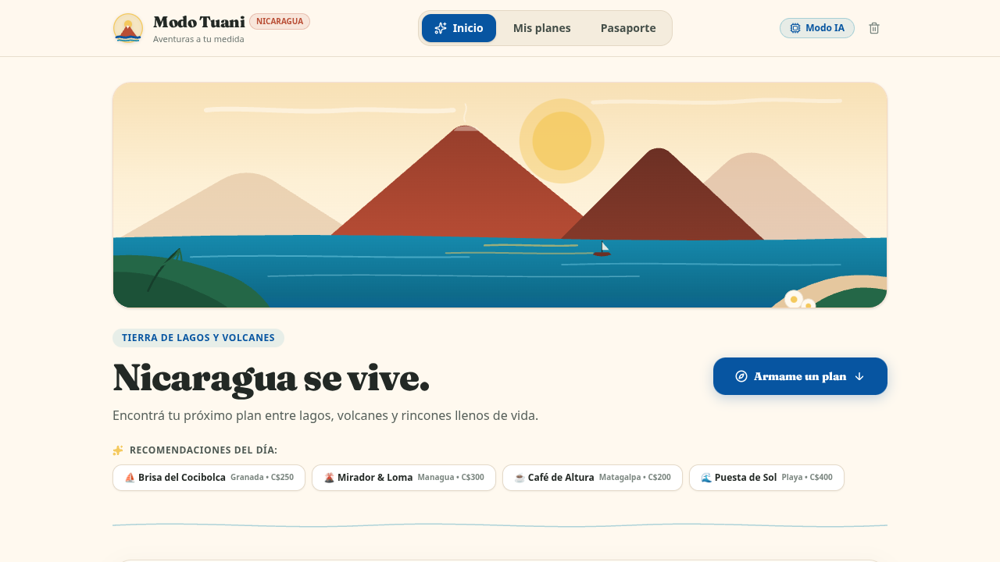
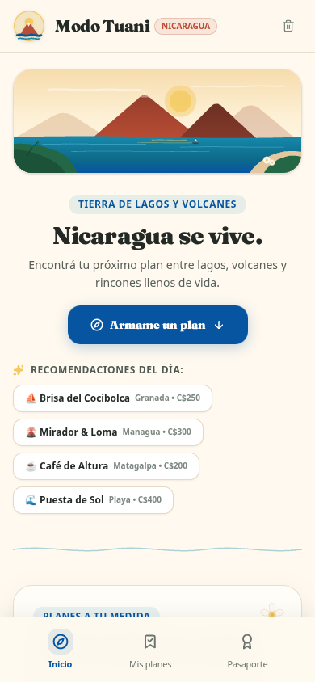
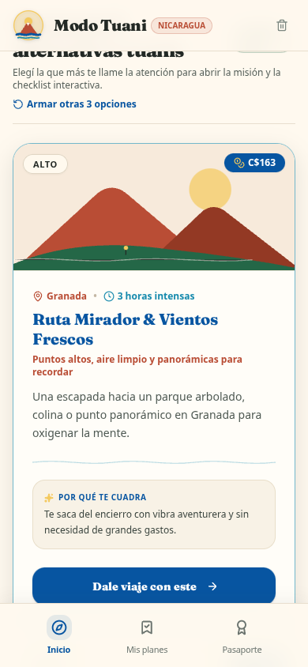
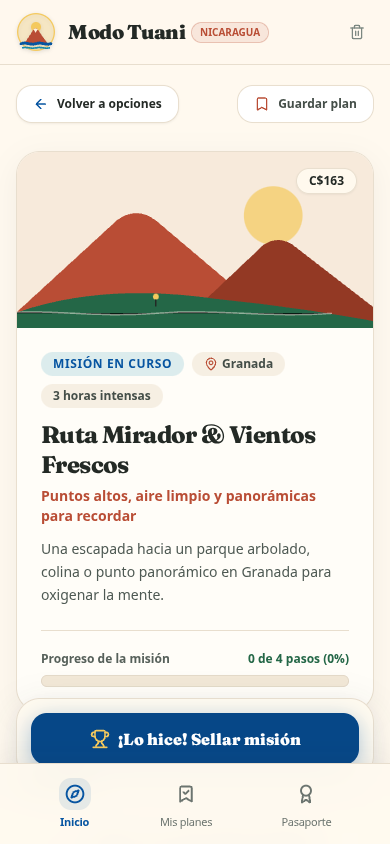
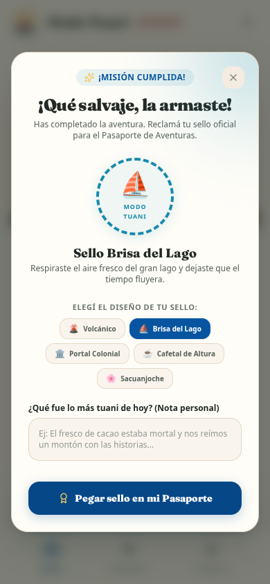
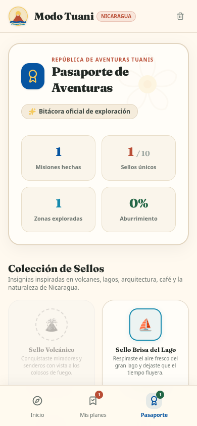

# 🌋 Modo Tuani — Aventuras a tu Medida

> **"Nicaragua se vive: encontrá tu próximo plan entre lagos, volcanes y rincones llenos de vida."**

Una aplicación web móvil y responsiva que transforma el aburrimiento en pequeñas aventuras personalizadas con el calor, la vibra y el esplendor de Nicaragua. Indicá tu ciudad, presupuesto, tiempo disponible, compañía y estado de ánimo, y la app te propone tres alternativas únicas convertidas en misiones interactivas con checklist y sellos para tu pasaporte de viaje.

---

## 📸 Capturas de Pantalla

### 🖥️ Vista de Escritorio — Inicio Panorámico


---

### 📱 Experiencia Móvil

| Inicio & Recomendaciones | Postales de Aventuras | Detalle de la Misión |
| :---: | :---: | :---: |
|  |  |  |

| Sello Desbloqueado | Pasaporte de Aventuras |
| :---: | :---: |
|  |  |

---

## ✨ Características Principales

### 1. 🧭 Generador Inteligente Híbrido (IA + Motor Local)
- **Modo IA con Gemini (`gemini-2.5-flash`)**: Cuando hay una clave configurada en el servidor, formula planes contextuales y vivos.
- **Motor Local 100% Resiliente**: Funciona desde el primer segundo **sin claves ni conexión externa**, combinando actividades reales de exploración, relax, cultura y gastronomía.
- **Sin inventar cuentos**: No inventa negocios fantasmas, horarios falsos ni precios irreales; propone actividades accesibles y espacios públicos icónicos.

### 2. 💰 Presupuesto y Tiempo Garantizados
- Moneda en **Córdobas (C$)** por defecto o **Dólares ($)**.
- Modo especial **C$ 0 (¡Gratis!)**: si el presupuesto es cero, cada paso y gasto se calcula estrictamente sin costo.
- Rangos de tiempo realistas: 30 minutos exprés, 1 hora puntual, 3 horas (tarde tuani) o todo el día (de viaje).

### 3. 📋 Misión Interactiva con Checklist
- **3 a 5 pasos concretos** con duración estimada y costo por persona o grupo.
- Casillas interactivas que tachan el paso y actualizan la barra de progreso en tiempo real.
- **"Cambiar este paso"**: Sustituí cualquier paso por otra alternativa temática con un solo toque sin rehacer todo el plan.
- **"Giro Inesperado" 🎲**: Un reto espontáneo, divertido y gratuito (inventar una micro-historia, cazar detalles arquitectónicos, tomar una foto estilo portada de disco, componer una rima).
- **Desglose de presupuesto** y lista de **"Qué llevar"**.
- **Plan alternativo por lluvia ☔**: Solución bajo techo si se viene el aguacero.

### 4. 🛂 Pasaporte de Aventuras & Álbum de Sellos
- Bitácora con estética de cuaderno de viaje contemporáneo en papel marfil.
- **Sellos coleccionables exclusivos**:
  - 🌋 *Sello Volcánico* (caminatas y miradores)
  - ⛵ *Sello Brisa del Lago* (Cocibolca / Ometepe / agua)
  - 🏛️ *Sello Portal Colonial* (Granada / León)
  - ☕ *Sello Cafetal de Altura* (Matagalpa / Jinotega)
  - 🌸 *Sello Sacuanjoche* (naturaleza y flora nacional)
  - 🏺 *Sello Barro & Espíritu* (artesanía de San Juan de Oriente)
  - ✨ *Sello Cero Bolas* (hazañas sin gastar un solo córdoba)
  - 🎲 *Sello Giro Inesperado* (retos espontáneos superados)
- Contador de misiones hechas, sellos únicos, zonas exploradas y registro de notas personales con fecha.

### 5. 🔒 Privacidad y Almacenamiento Local
- **Sin registro obligatorio ni contraseñas**.
- Todo se guarda en `localStorage`: preferencias, planes activos, checklist y pasaporte.
- Botón discreto en la cabecera para consultar el modo del motor o **borrar todos los datos locales** si deseás reiniciar desde cero.

---

## 🎨 Identidad Visual y Paleta de Nicaragua

Inspirada en el paisaje natural, la arquitectura colonial y la calidez del pueblo nicaragüense:

| Muestra | Nombre | Código Hex | Uso en la App |
| :---: | :--- | :--- | :--- |
| 🟨 | **Blanco Cálido** | `#FFF9EF` | Fondo principal y tarjetas tipo marfil |
| 🟦 | **Azul Profundo** | `#0755A1` | Botones de acción principal y navegación activa (Bandera nacional) |
| 🌊 | **Azul Lago** | `#168AAD` | Detalles de agua, brisas y lago Cocibolca |
| 🧱 | **Terracota** | `#B94D35` | Tejas coloniales, barro artesanal y etiquetas |
| ☀️ | **Amarillo Sol** | `#F4C95D` | Moneda, insignias y toques de luz |
| 🌿 | **Verde Bosque** | `#246747` | Naturaleza, checkmarks y estados completados |
| 🌋 | **Carbón Volcánico** | `#232925` | Tipografía principal de alto contraste |

### Tipografía
- **Fraunces**: Serif elegante y expresiva para encabezados, nombres de misiones y títulos del pasaporte.
- **Manrope**: Sans-serif geométrica, moderna y de alta legibilidad para el cuerpo y formularios.

---

## 🛠️ Tecnologías Utilizadas

- **React 19** + **TypeScript**
- **Vite 8**
- **Tailwind CSS v4**
- **Express + Node.js** (backend full-stack con proxy para la API de Gemini)
- **@google/genai SDK** (Google Gen AI TypeScript SDK)
- **Lucide React** (iconografía consistente)
- **Node Test Runner (`node:test`)** para pruebas unitarias de lógica pura
- **Playwright** para verificación y pruebas visuales en navegador real

---

## 🚀 Instalación y Uso Local

```bash
# 1. Clonar o ingresar al proyecto
cd applet

# 2. Instalar dependencias
npm install

# 3. (Opcional) Configurar clave de Gemini en .env
# Si no se define GEMINI_API_KEY, la app corre al 100% con su generador local
echo "GEMINI_API_KEY=tu_api_key_aqui" > .env

# 4. Iniciar servidor de desarrollo en http://localhost:3000
npm run dev

# 5. Ejecutar pruebas unitarias
npx tsx --test src/utils/planGenerator.test.ts

# 6. Compilar para producción
npm run build
```

---

<p align="center">
  Hecho con orgullo y vibra nicaragüense 🇳🇮 <b>¡Dale viaje!</b>
</p>
